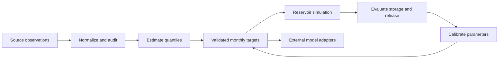

# Staged DZTR architecture

Observation and parameter objects connect independently testable layers.
Calculation modules do not read or overwrite spreadsheets.

1. **Parameterization, implemented:** Normalize dates/units, retain gaps and
   missing values, identify placeholders, estimate targets, and reproduce the
   Gardiner/Trinity workbooks. APIs live in `src/dztr`; compatibility imports
   remain in `dztr_param`. Source data remain in their original locations.
2. **Model, simulation and evaluation, implemented:** Five-zone operating rules,
   the coupled algebraic balance solver, historical fixed iterations, daily
   calendar handling, overflow diagnostics, and all ten MATLAB objective metrics.
   Portable and full-record Trinity references verify the port.
3. **Calibration baseline, implemented:** Explicit spin-up/calibration/validation
   selection, calibration-only target estimation and continuous held-out scoring.
   Settings, daily diagnostics and provenance are saved for reproducibility.
4. **Optimization preparation, implemented:** Shared 72-value candidates,
   calibration-derived percentile bounds, physical validation and negative-NSE
   release/storage objectives verified against saved MATLAB references.
5. **Optimization pilot, implemented:** A seeded NSGA-II adapter with normalized
   variation, an explicit evaluation budget, rejection accounting and a saved
   nondominated archive. Representatives are selected on calibration scores,
   then evaluated continuously on validation. Population sizes and search
   budgets are explicit settings.
6. **Seed and budget study, implemented:** Generation-aligned search prefixes,
   fixed-reference hypervolume, pooled calibration-only representative selection,
   descriptive parameter spreads and artifact integrity checks. The study measures
   progress and variability without automatically declaring convergence.
7. **Budget and fleet preparation, implemented:** Retrospective stopping
   diagnostics combine fixed-scale objective indicators, audit later progress,
   and compare fronts across seeds. Manifest preflight validates each reservoir
   independently and prepares normalized SI observations and configurations.
   Thresholds remain provisional and require independent extension and cohort
   audits before production budget recommendations.
8. **Checkpointed adaptive search, implemented:** Complete-generation optimizer
   snapshots preserve the archive, population order and RNG state. Verified
   identity checks allow cumulative stage budgets without reevaluating saved
   trials. Calibration-only stopping runs during optimization; explicit audit
   extensions test provisional stops. A flat process-pool example isolates
   Trinity seed jobs and an exploratory Gardiner job. General manifest-driven
   fleet scheduling and a diverse cohort audit remain further work.
9. **Population comparison, implemented:** Equal-budget population/seed matrices
   reuse verified complete checkpoints and isolate new jobs in one process pool.
   Nested calibration-only reports compare objective performance, front agreement
   and monthly target variability. Stopping remains diagnostic so all populations
   receive the same budget; interrupted owned jobs can resume independently.
   Broader cohort evidence is required before selecting fleet defaults.
10. **Simulation performance, implemented:** Monthly values are prepared lazily
   within each simulation and reused without changing solver arithmetic. Exact
   reference, seeded-search and continuation checks preserve scientific outputs.
   Integration retains historical checkpoint identities; new searches use new
   output folders. Selected replay timings do not establish fleet throughput.
11. **Integration:** Verify MESH and HydroLAKES conventions and batch workflows
   using the shared model and parameter objects.

The calibration namespace includes the baseline, NSGA-II search and verified
checkpoint continuation; MESH exporters require further work. Numerical compatibility choices
and reference provenance are documented in [the MATLAB port notes](matlab_port.md),
and the experiment protocol in [the calibration baseline notes](calibration_baseline.md).
Candidate conventions and objective verification are described in
[the calibration objective notes](calibration_objectives.md).
The search protocol and output artifacts are described in
[the optimization guide](optimization.md).
Seed and budget comparisons are described in [the convergence guide](convergence.md).
Budget diagnostics and reservoir manifests are described in
[the scalable calibration guide](scalable_calibration.md).
Checkpoint continuation, online stopping and exploratory multi-reservoir jobs
are described in [the adaptive calibration guide](adaptive_calibration.md).
Equal-budget population experiments are described in
[the population study guide](population_study.md).
