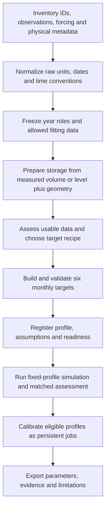

# Integrated DZTR implementation plan: geometry and data availability

Status: the preparation foundation and target-recipe/fixed-baseline workflow are implemented; see the [V1 operating instructions](data_availability_workflow_v1.md). New-recipe optimizer jobs, transfer and temporal model changes remain later deliveries. This document combines the original level-to-storage work, the [local geometry review](../outputs/level_storage_review_v1_20261017/README.md), the [Etienne implementation review](../outputs/etienne_review_v1_20261017_final/README.md), and the [completed cohort workflow](calibrated_cohort_workflow_v1.md). Existing calibrated profiles remain unchanged.

## Intended result and scope

One workflow should produce traceable DZTR parameter profiles from different combinations of observations, geometry and independent modeled flow. A reservoir can have several comparison profiles, each with a declared source and assumptions, while retaining one explicit application profile. The scientific meaning of a profile must remain visible in its export.

The initial inventory covers all **37 paper reservoirs**. It preserves **32 completed monthly profiles**, **Bull Lake's separate conditional interval workflow**, and **four source-gated cases**. The original 65-reservoir workbook and 77-curve audit are additional metadata/geometry inventories. The 6,824 ReGeom curves are potential geometry coverage; they are not 6,824 observed level series or calibration-ready reservoirs.

Build a complete preparation and benchmark path first. Local recalibration follows only where data, parameter bounds and observation operators support it. Existing selected parameters and checkpoints remain the reference.

## Shared sequence



The inventory occurs twice in different roles: a preliminary source inventory establishes what exists; a final capability assessment establishes what can actually be used after conversion and quality checks. This allows geometry to contribute storage without fitting its reference from held-out observations.

Independent source references can be applied before the split. Any reference estimated from observations, all observation-derived percentiles/bounds, and benchmark naturalized-flow climatologies use the declared fitting mask. Reuse existing frozen masks when comparing methods on the completed cohort.

## Four independent choices in a profile

| Choice | Examples | Purpose |
|---|---|---|
| Storage source | Direct volume; level plus surveyed curve; level plus ReGeom; assumed fractions | Defines the origin and uncertainty of storage information. |
| Parameterization recipe | `observed_monthly`, `level_geometry_monthly`, `flow_only`, `storage_only`, `ungauged_cr1`, later `transferred` | Defines how the six target columns are generated. |
| Forcing and numerical treatment | Independent hydrologic forcing or reconstructed net inflow; native solver, signed-net policy, conditional interval model, declared root policy | Defines the water balance and simulation assumptions. |
| Calibration/evaluation policy | Mixed years; pooled or equal-regime loss; storage/release objectives; observation operator | Defines what evidence can constrain or assess the model. |

Do not infer any of these from the others. In particular, geometry-derived storage does not determine a signed-inflow interpretation, and the name of a parameterization recipe does not certify its source data.

## Storage preparation: build on the existing work

Reuse the design in `dztr_param/res_data_est_from_hydrometric.py`. Preserve that legacy API and implement a new batch adapter around explicit geometry profiles.

A geometry profile contains:

- Geometry/source identity, verified reservoir linkage, optional verified GRanD ID, source bytes/hash and original geometric metadata.
- An SI curve with `depth_m`, `storage_m3` and, when available, `area_m2`.
- Coordinate meaning, supported tabulated domain, storage definition and comparison of curve-top volume with the adopted reservoir capacity.
- A fixed reference pair, `reference_level_m` and `reference_depth_m`, with its evidence or assumption and fitting-period signature.
- Level observation time basis, geometry approximation, quality flags and uncertainty scenarios.

Convert using:

```text
depth(t) = reference_depth_m + level(t) - reference_level_m
storage(t) = V(depth(t))
```

Prefer an independently documented reference. Allow a calibration-maximum reference only as an explicitly declared exploratory profile when its other requirements are met. Never compute the anchor from the complete calibration-plus-assessment record or move it after inspecting performance. Levels above the supported curve later in assessment remain flagged; they must not trigger reanchoring or clipping.

Read the curve once and interpolate the whole series. Preserve missing levels and unsupported coordinates with explicit flags. Reject ambiguous or conflicting units/dates. Store the original level series alongside derived storage. Do not overwrite an independently supplied storage record.

The existing audit findings become capability-specific checks:

| Finding | Treatment |
|---|---|
| Negative height placeholders in five legacy records | Treat the height as missing. A usable tabulated depth curve can still be considered if a valid reference pair independently defines its coordinate; do not interpret the negative header as physical height. |
| Header height beyond the last tabulated point | Use the actual supported curve domain. An extension requires a documented separate rule/profile; do not inherit the legacy flat extension silently. |
| Curve-top volume differs from catalog/adopted capacity | Retain all values and flag the discrepancy. Any volume rescaling must be an explicit source/assumption profile, never an optimizer repair. |
| Area/storage integral mismatch | Retain the supplied volume curve as an approximate conversion where justified. Separately flag suitability for area-flux coupling and inverse level calculations. Do not require area-based evaporation functionality to implement a volume-only input adapter. |
| Daily mean level input | Record that `V(mean(level))` is a storage proxy. It is not automatically end-of-day storage or mean storage. Declare a compatible observation operator or an explicit exploratory proxy comparison. |

Surveyed curves and approximate ReGeom curves use the same adapter, with different provenance/quality. Satellite level series can later use this adapter after provider-specific normalization; the existing Canadian fetcher is not a global satellite data connector.

## Target recipes and local calibration

Each recipe composes a storage estimator and a release estimator. All successful recipes return the existing twelve-month, six-column target contract in SI. They share interpolation, percentile, ordering and physical checks.

| Recipe | Storage targets | Release targets | Local response calibration |
|---|---|---|---|
| `observed_monthly` | Calibration-only monthly P10/P45/P85 of usable supplied storage | Calibration-only monthly P10/P45/P85 of observed release | Existing joint storage/release policy. |
| `level_geometry_monthly` | The same monthly estimator applied to usable level-derived storage | Monthly observed release percentiles | Joint calibration only with a declared observation operator; geometry uncertainty and proxy status remain visible. |
| `flow_only` | Fixed 0.20/0.30/0.97 fractions of adopted capacity | Monthly observed release P10/P45/P85 | Release only; initial implementation keeps the assumed storage fractions fixed. |
| `storage_only` | Monthly supplied or geometry-derived storage percentiles | An explicitly supplied release prior; first optional benchmark uses annual naturalized-outflow P5/P30/P97 | Storage only, with release targets fixed initially; without a release prior, report `needs_release_prior`. |
| `ungauged_cr1` | Fixed 0.20/0.30/0.97 capacity fractions | Annual naturalized-outflow P5/P30/P97 | No local response optimization when no responses are available. |
| `transferred` | Donor-based estimate | Donor-based estimate, possibly combined with local usable information | Later extension with reservoir-level holdout testing. |

CR1 and flow-only CR2 are documented benchmarks from [Gaborit et al. (2022)](https://doi.org/10.1139/cjce-2021-0507). The proposed storage-only hybrid is a separate extension, not a published CR1/CR2 result. Naturalized outflow must have its own identified model/source; do not silently substitute raw inflow or regulated release.

Where a source-defined channel limit exists, retain its meaning and evidence. Otherwise the benchmark channel target can use fitting-period P99 of the corresponding release source, labeled as an empirical proxy. It is not a certified engineering capacity.

A recipe selection policy uses declared available information and quality before performance is examined. It records rejected recipes and missing dependencies. An unusable storage source can support an explicitly permitted alternative recipe, but the original issue remains visible. Failure of a chosen method must not silently switch sources, capacity or method.

Common math can remain small:

```text
monthly_percentiles(series, fit_mask, estimator)
annual_percentiles(series, fit_mask, estimator)
capacity_fraction_targets(capacity, fractions)
assemble_targets(storage_targets, release_targets)
validate_targets(targets, physical_metadata)
```

An annual-observed control, analogous to GNR_fixed, can use the same annual estimator and repeat its results over twelve months. It is an optional comparison profile rather than another pipeline.

Bounds follow the variables and sources actually being fitted. Do not obtain storage bounds from invented storage observations in flow-only cases. Single-response objectives need an explicit adapter; do not duplicate one scalar loss into two fictitious objectives. Keep geometry/reference uncertainty separate from the operational target variables in the first implementation.

## Protocol and observation rules

Keep the existing mixed-year design with at least **65% calibration coverage**, warmup, actual calendar gaps and continuous state evolution. Reuse the currently declared pooled/equal-regime mode for controlled comparisons. Report unavailable regimes or undefined NSE explicitly. Calibration and assessment years are never concatenated as adjacent simulated days.

Profiles with no response observations can estimate a forcing-based reference climatology and simulate, but cannot report local calibration or validation skill. A genuine new ungauged application can declare its available historical forcing reference period; the 65% response-calibration rule is not a claim that unobserved responses were calibrated.

Declare the observation operator before calibration: point storage, interval mean storage, daily mean release, or level over its recorded observation interval. The operator must match what the solver can supply. An unsupported operator is a separate dependency, not permission to relabel the observation. Existing native profiles retain their frozen historical convention. New proxy comparisons must identify their approximation.

Storage derived from a geometry approximation is a response product with uncertainty. Agreement with it is not independent validation of the curve. Where measured storage or appropriately timed levels are available, use them for a separate geometry assessment.

Retain root-selection policies, physical storage limits and independent conservation checks. Do not import the archive's fixed iteration count as a convergence guarantee, its capacity-expanding repair, candidate-dependent scoring masks, or observed-mean adjustment of assessment storage. Capture invalid states and no-root events as explicit failures.

## Registry and outputs

Keep `reservoir_id` as the complete inventory key; a GRanD ID is nullable and only added through a verified mapping. Use `profile_id` to distinguish several methods/scenarios for the same reservoir. A GRanD ID alone cannot select one of several profiles without a declared profile/default.

Proposed scientific profile fields:

```text
reservoir_id, GRAND_ID, profile_id, profile_version
parameterization_method, storage_source_kind, release_target_source
geometry_profile_id, level_reference_id, observation_time_basis
capacity_source, storage_coordinate, channel_target_source
forcing_source, forcing_dependencies, initialization_policy
year_selection_signature, fitting_data_signature, quantile_method
cost_mode, objective_variables, observation_operator, numerical_profile
assumptions, source_gates, validation_receipt, input_and_code_hashes
```

Readiness is stage-specific: `geometry_readable`, `storage_conversion_ready`, `targets_ready`, `simulation_ready`, `calibration_ready` and `assessment_ready`, each with reasons and conditions. Source confidence/approximation status is recorded separately. Targets can be prepared when inflow is missing, while simulation remains unavailable. A completed calibration is not source certification.

Proposed persistent campaign output:

```text
outputs/<campaign>/
    inventory.csv                         # every paper reservoir retained
    profile_registry.json                 # profiles and reasons for selection
    prepared/<reservoir_id>/<profile_id>/
        observations_si.csv
        geometry_and_reference.json
        selection.json
        monthly_targets_si.csv
        provenance.json
    jobs/<reservoir_id>/<profile_id>/seed_<seed>/
        ... checkpoints and logs, when optimization is applicable
    report/
        reservoir_profiles_by_GRAND_ID.csv
        monthly_targets_by_profile.csv
        performance_comparison.csv
        assumptions_and_failures.csv
        README.md
```

Unavailable targets stay absent, with reasons; zeros are not missing-data replacements. Parameter exports keep the current six SI column names and provide method/profile identifiers. Existing parameter tables and result directories remain immutable.

## Comparison design: distinguish two scientific questions

**Controlled parameterization comparison:** use the same forcing, initial states, dates, solver and scoring observations while hiding selected responses from parameter generation. This isolates how target recipes behave. If forcing or initialization depends on the hidden observations, label the result conditional. Existing 32-reservoir data support this first experiment where required inputs are available.

**Availability-faithful application:** restrict all target generation, forcing, initialization, reference levels, physical adjustments and method selection to information genuinely available in that scenario. Independent forcing and a permitted initialization policy are required to claim a fully ungauged test. A source-reconstructed inflow or hidden observed initial storage violates that stronger claim.

Freeze the reference assessment data. Do not compare storage NSE gains computed against different geometry-derived truths as though they used identical observations. Compare release on common observed release support; compare storage/level on a common independently identified coordinate and matching operator. Report missing support and low variance, including source conversion failures, without candidate-dependent deletions.

For learned transfer, hold out entire reservoirs. Donor selection and learned rules exclude the omitted reservoir's observed responses, calibrated parameters and assessment skill. Target-reservoir metadata may be used only if independently available in the declared application. Keep a simple CR1/CR2 reference alongside transfer results.

## Modules and reuse

Use new versioned modules so existing source-pinned experiments remain reproducible. Initial boundaries can be:

| Proposed module | Responsibility |
|---|---|
| `workflows/geometry_v1.py` | Geometry profiles, coordinate/reference checks and batch level conversion. |
| `workflows/observation_operators_v1.py` | Compare simulated states/fluxes/levels with the quantity and time interval actually observed; identify unsupported cases. |
| `strategies/data_availability_v1.py` | Capability records, deterministic route policy and composable target estimators. |
| `strategies/availability_objectives_v1.py` | Explicit single-response/joint objective adapters; no response fabrication. |
| `workflows/data_availability_v1.py` | Stage controller, registry, provenance, reuse and persistent independent jobs. |
| `tools/data_availability_v1.py` | User command for inventory, prepare, simulate, calibrate and report stages. |

Reuse the existing observation normalization, percentile methods, target schema, representative-year selection, solver/root policies, checkpoint engine and independent mass-balance checks. Reuse code through public or narrow adapter boundaries rather than copying scientific equations. New source signatures include all consumed modules and scientific input profiles. Changed geometry, year masks, objectives or temporal operators create a new job identity; old checkpoints cannot continue under a changed objective.

Selected geometry tables and profile metadata belong in a new versioned repository data directory. External full catalogs can remain reference inputs. Temporary/tool caches stay on D: under `.cache`; scientific trajectories, profiles, checkpoints and logs remain persistent versioned artifacts.

## Delivery sequence and completion criteria

| Delivery | Concrete scope | Completion criteria |
|---|---|---|
| **1. Preparation foundation** | All-37 source/capability inventory; geometry profile and batch conversion; fixed period/reference handling; stage-specific readiness. | Every paper reservoir has a record; existing status/IDs are preserved; direct-storage inputs reproduce unchanged; geometry checks cover supported points, missing values, references and time basis. |
| **2. Target recipes and fleet baselines** | Shared builders for observed/geometry monthly targets, flow-only and CR1; storage-only when its explicit release prior exists; profile registry and GRanD exports. | All eligible profiles have 12-by-6 SI targets and provenance; unready profiles have reasons; no bounds/capacity are silently changed; fixed-profile benchmark reports use common assessment definitions. No optimizer required for this delivery. |
| **3. Calibration and comparative assessment** | Matched observation operators for new observations, objective adapters, explicit prior/fitted-variable choices, persistent jobs, baseline/seed/regime/seasonal/zone/peak diagnostics. | Appropriate response objectives only; unsupported time operators remain explicit dependencies; same frozen selection policy; held-out data cannot choose a seed/method/geometry; common-budget comparisons have compatible identities and separate new runs where needed. |
| **4. Transfer and temporal improvements** | Reservoir-level transfer tests; separately versioned daily target interpolation with any required extensions to the solver/observation operators. | Donor holdout is genuine; simple benchmarks remain; daily interpolation passes year-wrap/leap-year/ordering and root/balance tests; fixed parameters are tested before any recalibration. |

Do not wait for every source-gated reservoir to become ready before completing the fleet path. Keep them in inventory and report their precise missing dependencies. A curve reference cannot by itself resolve Ghost's storage coordinate or Bennett's forcing interpretation.

Use Gardiner for an initial conversion check because its ReGeom curve and existing storage/release reference are available. Actual gauge levels and their reference must still be identified; their presence is not inferred from curve availability. Run the same preparation/report command over the full eligible fleet after that adapter is verified, rather than creating reservoir-specific scripts.

## Necessary verification

Focused scientific checks during implementation should cover:

- Exact tabulated values and interpolation; SI conversions; missing levels; duplicate dates; strict supported domains; height placeholders; monotonicity and capacity discrepancies.
- A held-out higher level cannot change a frozen calibration anchor, derived calibration storage, target estimates or bounds.
- Identical supplied-storage inputs reproduce the existing estimator; equivalent source curves/units give identical SI results.
- Direct, geometry, flow-only, storage-only and no-response cases receive appropriate recipes/objectives/readiness. No-observation cases cannot launch a response optimizer.
- Naturalized outflow is distinguished from inflow and regulated release; target-dependent forcing/initialization is reflected in the experiment label.
- Fixed scored observations do not disappear when a simulated state fails; zeros remain valid where physically permitted; undefined NSE is reported.
- Source transformations apply once; signed forcing, clock, root policy and spill accounting remain explicit; physical limits and independent mass balance hold.
- Registry/profile identities distinguish different recipes, geometry references, masks, operators and assumptions. Resume is allowed only for identical scientific identities.
- Optional daily interpolation uses dated anchors and passes leap-year, month-boundary and year-wrap checks. Its solver/observation changes are isolated from the frozen native profiles.

Run the complete regression suite once at the end of each substantial implementation delivery, after focused checks pass. Do not rerun optimization to test document/schema changes. Reuse verified scientific outputs, maintain durable job logs/checkpoints and report the fleet in batches.

The first implementation should deliver **the inventory plus geometry preparation**, followed directly by **all eligible target recipes and a fleet baseline report**. This incorporates the user's existing work and establishes the full preparation-to-assessment path before adding more optimizer experiments.
