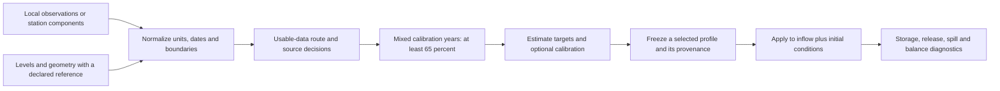

# DZTR researcher documentation

Estimate reservoir operating targets, calibrate them where observations exist,
and apply frozen profiles in hydrological models. Start with the
[portable application guide](portable_application_v1.md); it needs no private
experiment archives. The [scientific assessment](scientific_assessment_v1.md)
explains the evidence and limitations behind the available methods.

| Task | Guide |
|---|---|
| Install and reproduce three public applications | [Portable application](portable_application_v1.md) |
| Understand commands, clocks and file contracts | [Public interface](public_interface_v1.md) |
| Prepare a new reservoir | [New-reservoir checklist](new_reservoir_v1.md) |
| Choose a data-availability method | [Four-route workflow](four_route_workflow_v1.md) |
| Understand level datum and geometry choices | [Shared geometry workflow](shared_geometry_workflow_v1.md) |
| Understand wet/dry/normal year selection | [Representative-year calibration](representative_year_calibration.md) |
| Choose release, storage or weighted objectives | [Full-data scalar calibration](full_data_scalar_comparison_v1.md) |
| Interpret roots, failures and water conservation | [Root policies](root_policy_review.md), [interval simulation](interval_simulation.md) |
| Review performance and computational budgets | [Scientific assessment](scientific_assessment_v1.md) |
| Download, cite and verify a release | [Release and citation](release_v0_3_0.md) |

The stable command is `dztr` (also `python -m dztr`). Versioned run managers
remain the scientific backends. Earlier guides describe frozen experiments and
can refer to private `outputs/` directories; those paths are archive references,
not prerequisites for the portable quick start.

The GitHub Pages outlet builds from these Markdown sources after the public
Ubuntu and Windows application checks pass. Version 0.3.0 uses the MIT license.
No software DOI has been registered; the published model paper has its own
[existing DOI](https://doi.org/10.5194/hess-23-3735-2019).
