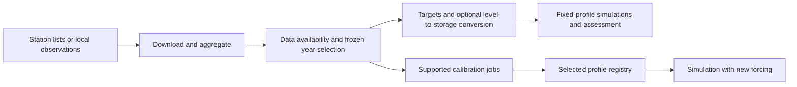

# One gateway for DZTR runs

Use `tools/dztr_run.py` to plan, execute, resume and inspect a saved run. The run
configuration links the existing station, parameterization, calibration and
simulation implementations. Every run records its effective decisions, input
hashes, stage outputs, status and logs under a fresh `outputs` directory.

The important distinction is between **generating targets**, **running a fixed
profile**, and **optimizing parameters**. Each is an explicit operation. A run
does not start optimization just because targets exist.



## Start with the local Gardiner example

From the repository directory, redirect project caches once per shell:

```powershell
& .\tools\Set-ProjectCache.ps1
python -B tools/dztr_run.py plan --config configs/run_manager_gardiner_v1.json
python -B tools/dztr_run.py run --config configs/run_manager_gardiner_v1.json --output outputs/my_gardiner_run_v1
python -B tools/dztr_run.py status --output outputs/my_gardiner_run_v1
```

`plan` performs no network request, model simulation or optimization. The
Gardiner example uses existing local observations and the exact previously
frozen mixed-year mask, estimates monthly observed targets, and runs one fixed
baseline. It performs no optimization and downloads no new observations. Its
new model configuration copies Gardiner's existing physical constants and
numerical settings; no capacity or root policy is adjusted.

To stop after target preparation, add `--until targets`. To continue or check
completed work without repeating it:

```powershell
python -B tools/dztr_run.py run --config configs/run_manager_gardiner_v1.json --output outputs/my_gardiner_run_v1 --resume
```

Resume verifies completed-stage artifacts and the original decisions, inputs
and code. Changed settings require a new run directory. Native optimizer
continuation retains its existing checkpoints and compatibility checks. A hard
process kill can leave a lock; inspect that no process is active before manually
clearing that specific lock. An interrupted preparation without its final
protocol cannot be certified automatically: retain it and use a fresh run.

The completed [Gardiner demonstration](../outputs/managed_gardiner_v1_20261017_final/implementation_release.md)
reproduced the earlier verified target values and simulation exactly. Its stages
were subsequently reused without rerunning them. A separate two-day live API
probe retrieved levels, without deriving storage or inferring a datum reference.

## Configure the scientific decisions

Keep scientific choices in JSON so the exact run can be reproduced. Command-line
flags select the configuration, output directory, stop stage and resume behavior.

| Decision | Configuration location |
|---|---|
| Station lists, acquisition dates and reasons for selecting them | `acquire` stage config: `inflow_stations`, `outflow_stations`, `level_stations`, `start`, `end`, `evidence` |
| Reservoir identity and GRanD mapping | Parameterization/calibration `reservoirs` entries; a missing verified GRanD ID remains null |
| Physical constants, initialization, sampling, units and root policy | Existing reservoir `model_config`; constants retain their source meanings |
| Parameter source | Data-availability `methods`: observed monthly, level/geometry monthly, flow only, storage only or CR1 |
| Fixed fitting/assessment years | Parameterization `selection_json` on the exact input calendar |
| New representative-year selection | Standalone parameterization `year_selection`: `minimum_fraction` (at least 0.65), `seed`, `water_year_start_month`, `warmup_years` |
| Native calibration split and objective | Existing calibration `year_selection`: `mixed` or `chronological`; `scoring`: `pooled` or `equal_regime` |
| Percentile estimator and channel-capacity treatment | Data-availability `quantile_method` and `channel_policy` |
| Geometry, gauge reference and mean-level approximation | Data-availability `supplemental_inputs`; see [geometry/reference rules](data_availability_workflow_v1.md) |
| Naturalized-flow prior and independence declaration | Data-availability `supplemental_inputs.<reservoir>.naturalized_outflow` |
| Search seeds, population, budget and concurrency | Native calibration `optimization.seeds`, `population`, `evaluation_budget`, `workers` |
| Profile and simulation forcing | `simulate` stage: `registry`, `forcing_csv`, one of `reservoir_id`/`grand_id`, optional `initial_state` JSON |

The native calibration backends retain their existing minimum 65% whole-year
protocol; they do not accept arbitrary new masks or new weaker-data objective
functions through this manager. Noncontinuous fitting years affect scoring and
target fitting; simulation state remains continuous through context and held-out
years. Explicit warmup/context handling and initial states still apply.

For local inputs, the CSV defines the simulation calendar. To use a different
calendar, prepare a new input/selection and an appropriate initial state; the
manager does not silently slice a frozen forcing record or reuse a mismatched
mask. All backend validation remains active.

## Station aggregation and levels

The earlier `fetch_hydrometric_data_ca` already supported lists of discharge
stations and one level gauge. The new acquisition stage follows those arithmetic
rules and additionally keeps raw response pages and station-by-station values.

- Sum independent inflow components and outlet components separately, in m3/s.
- A total requires every selected component that day. Missing data stays missing;
  measured zero flow stays zero.
- Download each unique gauge once per query. Preserve raw pages, source query,
  retrieval time, daily date labels, provider flags and station components.
- Select one level gauge in metres. Negative gauge heights can be valid; negative
  discharge needs an explicit additional interpretation. Levels are never summed.
- Multiple level stations require a datum/alignment and combination adapter, which
  is not implemented in this version.
- A tributary sum is a **gauged-inflow estimate**, not proof of total reservoir
  inflow. Ungauged lateral flows, routing/travel times, diversions and serial-gauge
  double counting require reservoir-specific evidence. No such correction is
  invented by the manager.

The ECCC provider returns **daily mean** data. Keep that timing in provenance;
daily mean flows are not automatically equivalent to the endpoint rates expected
by a particular solver. Water-level conversion requires a declared geometry
reference and an explicit mean-level proxy opt-in where applicable. Acquired
storage stays blank until that conversion is requested. See the
[ECCC daily-mean retrieval example](https://eccc-msc.github.io/open-data/usage/use-case_oafeat/use-case_oafeat-script_en/)
and [API pagination documentation](https://eccc-msc.github.io/open-data/msc-geomet/ogc_api_en/).

## Link stages without manually copying paths

Give each stage an ID and use a full `@stage.output` reference. For example:

```json
{
  "kind": "dztr_run_manager_v1",
  "schema_version": 1,
  "stages": [
    {
      "id": "download",
      "type": "acquire",
      "config": {
        "start": "1980-01-01",
        "end": "2011-12-31",
        "inflow_stations": ["YOUR_TRIBUTARY_1", "YOUR_TRIBUTARY_2"],
        "outflow_stations": ["YOUR_OUTLET"],
        "level_stations": ["YOUR_LAKE_GAUGE"],
        "evidence": "Replace these placeholders with verified reservoir gauge roles and timing."
      }
    },
    {
      "id": "targets",
      "type": "parameterize",
      "config": {
        "kind": "dztr_data_availability_v1",
        "schema_version": 1,
        "methods": ["level_geometry_monthly", "flow_only"],
        "reservoirs": [{
          "reservoir_id": "my_reservoir",
          "name": "My reservoir",
          "GRAND_ID": null,
          "observations_csv": "@download.observations_csv",
          "model_config": "inputs/my_model.json",
          "forcing_stage": "canonical",
          "source_gates": ["Review daily-mean forcing interpretation before simulation"]
        }],
        "supplemental_inputs": {
          "my_reservoir": {
            "levels_csv": "@download.levels_csv",
            "geometry_csv": "inputs/my_curve_si.csv",
            "geometry_format": "surveyed_si",
            "geometry_evidence": "Verified curve linkage to this reservoir",
            "level_time_basis": "daily_mean_level",
            "reference": {
              "level_m": 100.0,
              "depth_m": 10.0,
              "basis": "source_reference",
              "evidence": "Illustrative numbers: replace with a documented gauge-to-curve reference"
            },
            "allow_mean_level_proxy": true
          }
        }
      }
    },
    {"id": "baseline", "type": "baseline", "config": {"campaign": "@targets.campaign"}}
  ]
}
```

This example is a **template**, not a real station mapping or datum. Replace its
IDs, input files, reference and source decisions before use. The explicit source
gate preserves the unresolved forcing interpretation. Remove it only after the
source decision has been made and documented. Without sufficient inflow or a
usable level/reference combination, profiles remain unavailable in the report.

Use one acquisition stage per reservoir or station system, then pass their
outputs into a batch parameterization configuration. A single batch calibration
stage can include hundreds of reservoir entries; its existing worker setting
controls independent search jobs. There is no new top-level parallel optimizer.

References must name outputs of an earlier stage. Partial string substitution,
forward references, cycles and unknown outputs fail before execution. Stage
configurations can be inline objects or paths to existing JSON files; file paths
are resolved relative to the JSON that contains them.

## Calibration and later simulation

`configs/run_manager_calibration_v1.example.json` points to the existing native
twenty-reservoir configuration. **Running** this example starts a new calibration
campaign; `plan` is read-only. Backend `v1` and `v2` keep their original scientific
behavior and checkpoint identities. It does not import old completed campaigns
as new optimization results. To inspect historical results, use their existing
verified registries/reports rather than launching this example.

Add a later simulation stage with a registry output reference:

```json
{
  "id": "prediction",
  "type": "simulate",
  "backend": "v1",
  "config": {
    "registry": "@calibration.registry",
    "forcing_csv": "inputs/new_prepared_forcing_si.csv",
    "grand_id": 253,
    "initial_state": "inputs/new_initial_state.json"
  }
}
```

The native simulation backend requires forcing in its existing prepared SI
convention. A different start date requires explicit initial storage/release.
The data-availability baseline backend already supports its documented signed
forcing routes; the native calibration/simulation adapters do not gain new
signed-forcing or interval-mean capabilities from orchestration.

New flow-only/storage-only/CR1/level-derived target recipes still require their
own verified optimization objective/bounds/checkpoint adapters before they can be
calibrated through this gateway. Their fixed baselines are available now. The
manager preserves that distinction and does not promote source-gated reservoirs.

## Run outputs

`plan.json` pins the effective configuration, scientific code and direct input
hashes. `status.json` and `README.md` show stages and output locations. Each stage
has `resolved_config.json`, a completion receipt, scientific artifacts, and a
command log where an external backend is used. Raw Canadian response pages live
inside that stage's persistent inputs directory on D:; project caches and
temporary files remain in `.cache` on D:.

Dependent stages stop on an execution/verification error. Backend scientific
failures remain explicit per-reservoir receipts: completion of a batch operation
does not mean every reservoir passed. Generated report tables may be refreshed
by later stages, while scientific prepared inputs and job receipts are hashed.
