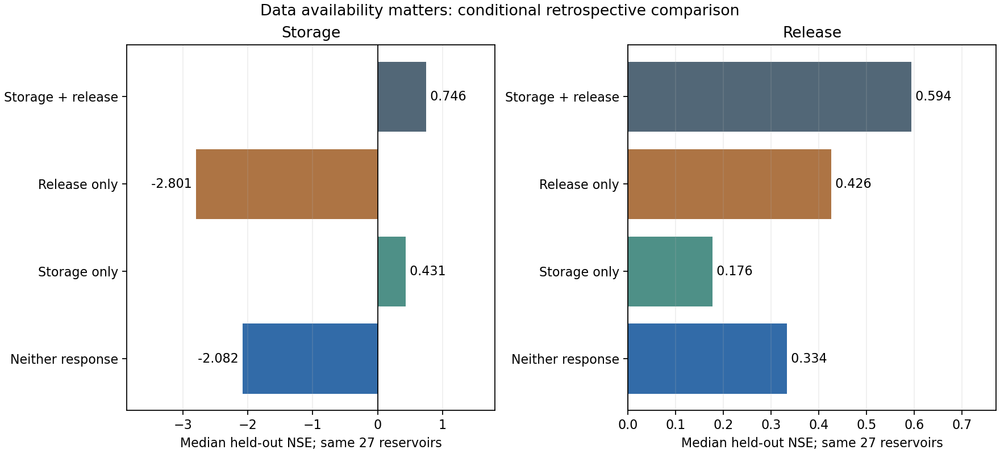

# What the completed DZTR workflow demonstrates

The model is the dynamically zoned target release formulation of
[Yassin et al. (2019)](https://doi.org/10.5194/hess-23-3735-2019).
The implementation adds explicit source preparation, parameter provenance,
mixed-year calibration, reproducible searches and fixed-profile application.
Etienne's archived implementation and
[study](https://doi.org/10.1139/cjce-2021-0507) informed the weaker-data benchmarks.
The mean-flow/donor fallback is an explicitly exploratory extension.

## Data availability and predictive behavior

The controlled benchmark requested **32 monthly-target paper reservoirs**.
All 37 paper reservoirs remain in its inventory: Bull Lake retains a separate
interval study; four source-gated cases have no admitted standard profile.
Later source reviews and collection imports do not silently change this
benchmark's membership or frozen parameters.

The main comparison uses the **same 27 reservoirs with successful, scored
trajectories across all four routes**, and the same frozen held-out masks:

| Responses available for fitting | Median storage NSE | Median release NSE | Both NSE positive |
|---|---:|---:|---:|
| Storage and release | 0.746 | 0.594 | 20/27 |
| Release only | -2.801 | 0.426 | 6/27 |
| Storage only | 0.431 | 0.176 | 11/27 |
| Neither | -2.082 | 0.334 | 4/27 |

**Storage observations matter for storage dynamics.** Release-only fitting can
produce useful release scores while storage remains poor. A positive release
NSE alone does not establish plausible storage or a successful joint model.
Storage-only fitting recovers more storage behavior but leaves release skill
limited by its transferred prior. The no-response recipe is a functioning
fallback with substantial storage limitations.

Completion and membership must remain visible. The available-case figures use
each route's actual successful subset and must not be read as a matched ranking:

| Route | Completed / requested | Median storage NSE | Median release NSE |
|---|---:|---:|---:|
| Observed storage and release | 32/32 | 0.717 | 0.638 |
| Release only, square-root-release objective | 27/32 | -2.801 | 0.426 |
| Storage only | 32/32 | 0.437 | 0.232 |
| Neither response | 31/32 | -1.056 | 0.334 |

The remaining release-only cases lack successful selected profiles at the saved
checkpoint. The fixed no-response Tyuyamuyun simulation fails on 2001-04-01
with no feasible implicit root; the failure is preserved. A valid parameter
table does not guarantee successful simulation at every timestep.

[Machine-readable aggregate results](assets/researcher_v1/route_summary.csv) and
[reproduction receipt](assets/researcher_v1/assessment_receipt.json) accompany
this curated report. `tools/summarize_researcher_assessment_v1.py` verifies the
cached source manifest and reproduces the medians, counts and figure without
new simulations or optimization. Observation series are not included here.

## What was fitted and how much computation was used

| Route | Fitted information | Saved search checkpoint |
|---|---|---|
| Observed monthly | All 72 storage/release targets; joint calibration | NSGA-II, 512 evaluations per seed, three seeds |
| Flow only | Fixed capacity fractions; 36 release targets | DDS, 64 evaluations per seed of a frozen 512 horizon |
| Storage only | 36 storage targets; fixed release prior | DDS, 64 evaluations per seed of a frozen 512 horizon |
| Neither response | Fixed capacity fractions and mean-flow/donor release prior | Zero optimization evaluations |

Flow-only storage fractions are 0.20/0.30/0.97 of adopted capacity, with a declared
active-storage adaptation in three cases. Storage-only and no-response release
priors scale donor percentile-to-mean ratios by verified GRanD mean discharge
where available, otherwise by a labelled calibration-inflow proxy. Annual prior
targets repeat monthly; this does not recover a seasonal operating rule.

Different response access, initial states, target dimensions and search budgets
mean this comparison does **not isolate optimizer effects**. The separate
Gardiner full-data experiment compares DDS and GA with matched objectives,
72 fitted targets, bounds, seeds and 512 evaluations. It completed 12 searches
and 6144 evaluations; it supports the optional implementations, not a universal
optimizer ranking. Weighted storage/release priorities remain user inputs.

The workflow records evaluation budgets and persistent checkpoints. Consistent
cross-experiment elapsed-time measurements are not available here, so no
wall-time speedup is claimed. These checkpoints do not establish convergence.

## Scientific safeguards and interpretation

- Targets and bounds are fitted on calibration observations only. At least 65%
  calibration support is retained, with wet/normal/dry whole years and continuous
  simulation state. Held-out results do not choose the seed, weights or route.
- The MATLAB port is checked against Trinity references. Numerical policies
  retain explicit multiple-root choices and no-root failures, conservative
  overflow and independent water-balance checks.
- Level-derived storage retains geometry, datum/reference, storage-definition,
  observation-clock and approximation qualifications. A gauge datum is not
  automatically a lake bed.
- Balance-derived forcing uses observed storage/release and is conditional on
  those responses. Algebraic closure cannot establish independent forcing or
  independent forecasting skill. The external donor records are regional.
- Source-gated reservoirs remain deferred. Exploratory profiles are labelled;
  source certification and global transferability remain unproven.

The three portable historical examples reproduce archived predictions and
later-start model-state restarts exactly. These are application/reproducibility
checks, separate from the frozen held-out performance assessment above.
